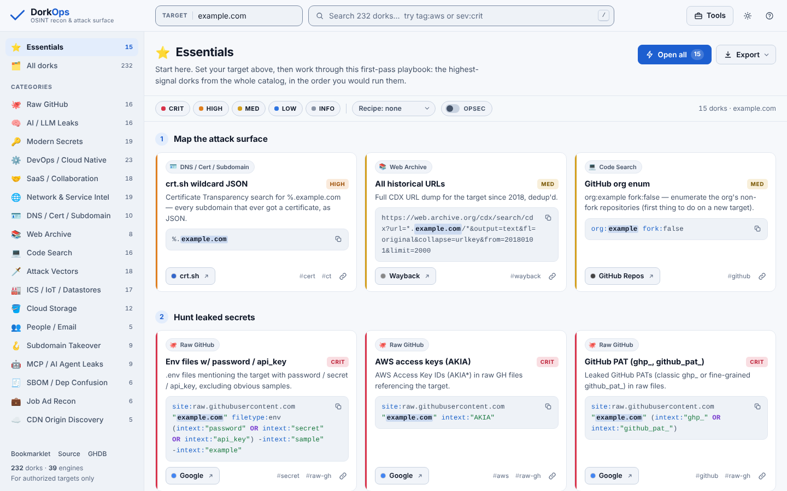

<div align="center">

# 🔍 DorkOps

**A single-file OSINT dork & recon toolkit — 232 curated dorks across 39 search engines, zero dependencies, runs entirely in your browser.**

[**▶ Live app**](https://dorks.bersec.me/) · [Report an issue](https://github.com/bersechub/dork-ops/issues) · [Contributing](CONTRIBUTING.md)

`Google` · `GitHub` · `grep.app` · `Shodan` · `FOFA` · `Censys` · `ZoomEye` · `urlscan` · `LeakIX` · `crt.sh` · `Wayback`

<picture>
  <source media="(prefers-color-scheme: dark)" srcset="docs/screenshot-dark.png">
  
</picture>

</div>

---

## What is DorkOps?

DorkOps turns a target domain into a curated, one-click battery of reconnaissance queries. You type a domain once; every dork in the catalog is instantly templated with it and linked to the search engine that answers it. It is built for **bug-bounty hunters and authorized red teams** who want to map an attack surface and hunt exposed secrets fast, without leaving the browser.

The entire tool is **one `index.html` file** — no build step, no server, no tracking, no external requests except the searches *you* choose to open. Drop it on any static host (or open the file locally) and it works.

> ⚠️ **Authorized testing only.** Every query is passive and runs against third-party search engines, but the intent — mapping a target's exposure — is only legal against assets you own or are explicitly authorized to test. See [Responsible use](#responsible-use).

## Highlights

- **Essentials — a first-pass playbook.** The app opens on 15 hand-picked, highest-signal dorks in the order you would run them: map the attack surface → hunt leaked secrets → find exposed data & docs → check the quick wins.
- **232 curated dorks** in **18 categories**, each with a **severity** (`crit` → `info`), a one-line reason *why it matters*, and the engine best suited to run it.
- **39 search engines** wired in — web search, code search, internet-wide scanners, certificate transparency, passive DNS and web archives.
- **Readable queries.** Every dork is shown in full with syntax colouring (operators, strings, booleans) and your target highlighted wherever it was substituted.
- **Modern secret coverage (2025–2026):** `sk-ant-`, `sk-proj-`, `ghp_`/`github_pat_`, `glpat-`, `sk_live_`, `hf_`, `r8_`, `lsv2_`, AWS `AKIA`, GCP service accounts, Azure SAS — plus DevOps leaks (tfstate, kubeconfig, Helm, ArgoCD), SaaS exposure (Notion, Airtable, Postman, Confluence), and **MCP / AI-agent** leaks.
- **A search DSL** over the catalog: free text, `tag:`, `sev:`, `engine:`, `cat:`, quoted phrases, and `-exclusions`.
- **Filters that stay in reach:** severity, recon recipes and OPSEC mode sit in a bar that follows you down the page.
- **8 built-in recon tools:** favicon hash (MurmurHash3 + MD5), ASN lab, permutation generator, bug-bounty scope importer, client-side JS secret scanner, Wayback parameter-wordlist generator, one-click secret-pattern hunts, and curated GHDB picks.
- **Exports** of exactly what is on screen: Markdown checklist, JSON, CSV, or straight to the clipboard.
- **Dark and light themes, full keyboard control, shareable deep links, and a drag-to-install bookmarklet.**

## Quick start

DorkOps is a static file. Any of these work:

```bash
# 1. Just open it
open index.html            # macOS   (xdg-open on Linux)

# 2. Or serve it locally
python3 -m http.server 8080   # then visit http://localhost:8080

# 3. Or use the hosted version
# https://dorks.bersec.me/
```

There is nothing to install or build. To self-host, copy `index.html` (plus the optional `_headers`, `robots.txt`, `sitemap.xml`, `og-image.png`) to any static host — see [Deployment](#deployment).

## Usage

### 1. Set a target

Type a domain into the **Target** box (e.g. `example.com`). Paste anything — a full URL, a wildcard like `*.example.com` — and it is reduced to a bare, lower-cased host when you press Enter. Every visible dork re-templates live as you type. Targets you have used are offered as autocomplete, and the last one is restored the next time you open the app.

### 2. Start with Essentials, then browse or search

The app opens on **⭐ Essentials**: a short playbook that takes you from mapping the surface to the quick wins. From there:

- **🗂️ All dorks** lists the whole catalog under its 18 category headings; each category is also one click away in the sidebar.
- The **search box** (`/` to focus it) searches the whole catalog from Essentials and All dorks, and stays inside the category when you are in one. It is a small query language:

| Syntax | Matches | Example |
| --- | --- | --- |
| `word` | free text across name, description, tags, engine, query | `stripe` |
| `"exact phrase"` | quoted phrase | `"private key"` |
| `tag:x` | dorks carrying tag *x* | `tag:aws` |
| `sev:x` | severity (`crit`/`high`/`med`/`low`/`info`, or `c/h/m/l/i`) | `sev:crit` |
| `engine:x` | dorks that run on engine *x* (key or name) | `engine:gh` |
| `cat:x` | category id or label | `cat:devops` |
| `-word` | **exclude** anything matching *word* | `s3 -wayback` |

Operators combine, e.g. `stripe sev:crit engine:gra -test`, and show up as removable chips under the title.

### 3. Filter

The bar above the results holds the filters, and stays pinned while you scroll:

- **Severity** — toggle `crit` / `high` / `med` / `low` / `info` on and off.
- **Recipe** — a curated preset over the whole catalog (see below).
- **OPSEC** — hides the authenticated internet-scan engines that log your query against your account (Shodan, FOFA, ZoomEye, Censys, Hunter.how, Netlas, Onyphe, BinaryEdge) plus urlscan. It is a per-machine safety setting and is never written to a shareable link.

| Recipe | What it shows |
| --- | --- |
| **First Pass** | Certificate and DNS discovery, at most three dorks per category |
| **Bug Bounty Triage** | High-signal secret & config leaks (raw GitHub, tfstate, S3, Postman, Notion…), at most four per category |
| **AI Era** | The AI/LLM and MCP/agent categories (pairs well with the JS recon tool) |
| **Shadow IT** | Certificate, DNS and subdomain discovery (pairs well with the Permutations tool) |
| **OPSEC-safe** | Only the quieter engines — no internet-scanner accounts |

### 4. Run the dorks

Each card shows the full query and a button for the engine it runs on (a padlock means that engine needs a login). Click it to open the search in a new tab, or:

- **copy icon** in the query box — copy the query text;
- **link icon** — copy the ready-made search URL;
- a **#tag** — filter the catalog by that tag;
- **Open all** — open every dork in the current view, one tab each (asks first above 5, never more than 50 at once).

### 5. Export

**Export** saves exactly what is on screen — after search, severity, recipe and OPSEC — as a **Markdown checklist**, **JSON** or **CSV**, or copies the Markdown to the clipboard. Handy for pasting recon steps into a report or ticket.

### Keyboard shortcuts

| Key | Action |
| --- | --- |
| `/` | Focus the search box |
| `Esc` | Clear the search / close dialogs and panels |
| `j` / `k` | Next / previous view |
| `c` | Copy the first visible query |
| `?` | Search syntax, shortcuts and the engine legend |

Single-key shortcuts can be switched off in the help dialog.

### Deep links

The view lives in the URL hash, so it is shareable:

```
https://dorks.bersec.me/#cat=ai-llm&target=example.com&sev=crit,high&filter=openai
```

`cat` is `essentials`, `all` or a category id; `target`, `sev`, `filter` and `recipe` are optional.

### Bookmarklet

Drag the **Bookmarklet** link at the bottom of the sidebar to your bookmarks bar. Click it on any site and DorkOps opens with that site's hostname as the target.

## The recon toolbox

Open **Tools** in the top bar. Everything here runs locally in your browser.

| Tool | What it does |
| --- | --- |
| **Favicon hash** | Computes the Shodan MurmurHash3 and Censys MD5 of a favicon (URL fetch or local file) and builds Shodan / FOFA / ZoomEye / Censys pivot links |
| **ASN lab** | Jump-off links to BGP / ASN explorers, then Shodan / FOFA / Censys / Netlas pivots by ASN |
| **Permutations** | Generates dev / staging / alt-TLD / typo variants of the target (AlterX-light) |
| **Scope importer** | Parses a HackerOne `structured_scope` JSON, a Bugcrowd asset list or a plain domain list; "Run on all" runs the current view against every in-scope target |
| **JS recon** | A client-side LinkFinder / SecretFinder — paste or fetch a JS file, extract endpoints, secrets and revealing comments |
| **Param wordlist** | Fetches the Wayback CDX for the target, ranks the unique query parameters by frequency and downloads a wordlist for ffuf / Burp |
| **Secret patterns** | One-click grep.app regex hunts for modern key formats (`ghp_`, `sk_live_`, `AKIA`, `sk-ant-`…) |
| **GHDB picks** | Curated, still-working Google Hacking Database dorks run against the target, plus links into the upstream database |

## Categories

<details>
<summary><b>All 18 categories</b> (click to expand)</summary>

| Category | Focus |
| --- | --- |
| 🐙 Raw GitHub | `raw.githubusercontent.com` — Google-indexed raw file content (env, keys, tfstate, kubeconfig) |
| 🧠 AI / LLM Leaks | OpenAI/Anthropic/HF/Replicate keys, vector DBs, exposed Ollama/Open WebUI/LiteLLM |
| 🔑 Modern Secrets | Prefix-format secret scanning (a TruffleHog/Gitleaks-style rule pack) |
| ⚙️ DevOps / Cloud Native | tfstate, kubeconfig, Helm, ArgoCD, source maps, Sentry, Firebase, Supabase |
| 🤝 SaaS / Collaboration | Public Notion, Trello, Airtable, Postman, Confluence, Loom |
| 🌐 Network & Service Intel | Shodan/FOFA/ZoomEye/Censys/LeakIX/Onyphe asset intel |
| 🪪 DNS / Cert / Subdomain | crt.sh, DNSDumpster, SecurityTrails, VirusTotal, Phonebook, Wayback, CommonCrawl |
| 📚 Web Archive | Wayback CDX — historical URLs, sensitive extensions, params, archived `.git`/robots |
| 💻 Code Search | GitHub, grep.app, Sourcegraph, searchcode, PublicWWW (analytics-ID pivots) |
| 🗡️ Attack Vectors | Open redirect, SSRF, LFI, XSS, SAML/OIDC, WordPress/Drupal/Magento, exposed `.git` |
| 🏭 ICS / IoT / Datastores | Modbus, MQTT, S7, RTSP cameras, exposed Elasticsearch/Mongo/Redis |
| 🪣 Cloud Storage | S3, GCS, Azure Blob, DO Spaces, R2, Backblaze, Wasabi, OVH |
| 👥 People / Email | Hunter.io, HIBP, LinkedIn pivot, Phonebook |
| 🪝 Subdomain Takeover | `can-i-take-over-xyz` fingerprints visible via Google |
| 🤖 MCP / AI Agent Leaks | MCP servers, Claude Desktop config, AutoGPT/Cursor/Continue, LangSmith |
| 🧾 SBOM / Dep Confusion | Exposed SBOMs and internal package patterns |
| 💼 Job Ad Recon | Job ads that disclose the internal tech stack |
| ☁️ CDN Origin Discovery | Pivot to the true origin behind Cloudflare/Akamai/Fastly |

</details>

## Privacy & security

- **No backend, no analytics, no cookies.** DorkOps never phones home, and nothing is requested when the page loads. The only network requests are the searches you explicitly open (in new tabs) and the fetches you trigger inside the recon tools. (One nuance: the first time you open a CommonCrawl dork, the app asks commoncrawl.org — the site you are about to visit — for its newest index name, and remembers it for a week.)
- **Local state only.** Your target history, theme, filters and last view are stored in `localStorage` on your machine.
- A strict **Content-Security-Policy** ships in the page `<meta>` and is reinforced by security headers in [`_headers`](_headers) (`X-Frame-Options: DENY`, `nosniff`, `Referrer-Policy: no-referrer`, HSTS, a restrictive `Permissions-Policy`).
- All outbound links use `rel="noopener noreferrer"` and `referrerpolicy="no-referrer"` so your DorkOps URL never leaks to the destination engine.

Found a security issue? Please report it privately — see **[SECURITY.md](SECURITY.md)**.

## Deployment

DorkOps is designed for **Cloudflare Pages** but works on any static host (GitHub Pages, Netlify, S3, `nginx`, …).

1. Serve the repository root as the site root.
2. The included [`_headers`](_headers) file applies security and caching headers on Cloudflare Pages/Netlify.
3. Update the canonical URL, `og:url`, `sitemap.xml`, and `robots.txt` if you host on a different domain than `dorks.bersec.me`.

Because everything is one file, you can also just email `index.html` to a teammate or keep it on a USB stick for offline use — only the search links need connectivity.

## Contributing

Adding a dork is a one-object change to the `DATA` array. See **[CONTRIBUTING.md](CONTRIBUTING.md)** for the item schema, the engine registry, the template placeholders (`{t}`, `{t_no_tld}`, `{date}`), severity guidance, the Essentials playbook, and how to test your change.

## Responsible use

DorkOps is a **defensive and authorized-testing** tool. Use it only against:

- assets you own,
- targets inside an authorized penetration-testing engagement, or
- programs whose bug-bounty scope explicitly permits reconnaissance.

Do not use it to target systems without permission, to mass-harvest data, or to access exposed secrets you are not authorized to access. Finding a leaked credential does not authorize using it — report it through the appropriate disclosure channel. You are responsible for complying with all applicable laws and program rules.

## License

Released under the [MIT License](LICENSE).

---

<div align="center">
<sub>Passive recon · authorized targets only · queries run in your browser.</sub>
</div>
