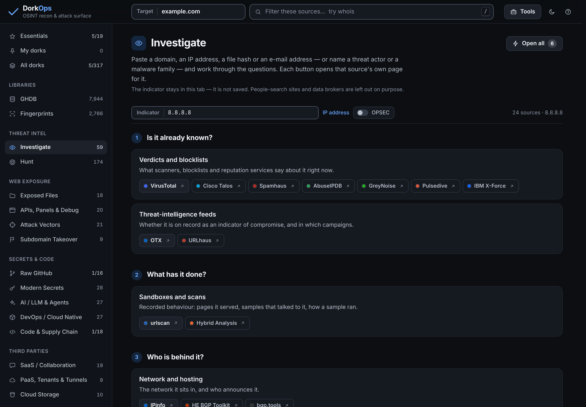

<div align="center">

# DorkOps

**A single-file OSINT dork & recon toolkit — 317 curated dorks across 41 search engines, every one scoped to your target, with progress tracking per target. Zero dependencies; runs entirely in your browser.**

**Plus, on demand:** the best of the Google Hacking Database, product fingerprints ranked by CISA's exploited-vulnerabilities list, published fingerprints of adversary infrastructure, and an indicator look-up for threat-intelligence work.

[**▶ Live app**](https://dorks.bersec.me/) · [Report an issue](https://github.com/bersechub/dork-ops/issues) · [Contributing](CONTRIBUTING.md) · [Changelog](CHANGELOG.md)

`Google` · `GitHub` · `grep.app` · `Shodan` · `FOFA` · `Censys` · `ZoomEye` · `urlscan` · `LeakIX` · `crt.sh` · `Wayback`

<picture>
  <source media="(prefers-color-scheme: dark)" srcset="docs/screenshot-dark.png">
  
</picture>

</div>

---

## What is DorkOps?

DorkOps turns a target domain into a curated, one-click battery of reconnaissance queries. You type a domain once; every dork in the catalog is instantly templated with it and linked to the search engine that answers it. It is built for **bug-bounty hunters and authorized red teams** who want to map an attack surface and hunt exposed secrets fast, without leaving the browser.

The entire tool is **one `index.html` file** — no build step, no server, no tracking, no external requests except the searches *you* choose to open. Drop it on any static host (or open the file locally) and it works. The three [libraries](#7-libraries) are plain data files that sit next to it and load only when you open them; without them everything else still works.

> ⚠️ **Authorized testing only.** Every query is passive and runs against third-party search engines, but the intent — mapping a target's exposure — is only legal against assets you own or are explicitly authorized to test. See [Responsible use](#responsible-use).

## What sets it apart

- **Every dork is about *your* target.** Scanner queries are scoped by the target's TLS certificate, reverse DNS and root domain; secret formats run as a regex *next to the target's domain* on GitHub. Nothing in the catalog returns "the whole internet".
- **It works today.** Engine links and query syntax were reviewed against the engines' current documentation in November 2026 — Censys Platform (CenQL), ZoomEye's base64 queries, GitHub's `path:` and regex search — and dead engines were removed. A lint keeps it that way: an engine nobody uses, or a dork that is not scoped, fails CI.
- **It tracks the session.** Running a dork ticks it off *for that target*. **Run next** steps through a playbook one key press at a time. Progress, pins and your own dorks stay in your browser.
- **It covers what gets exploited.** Exposed files and debug endpoints, modern secret formats (including the new prefixed Cloudflare, Vercel and Supabase keys), cloud buckets, AI / MCP leaks — and the VPN and edge appliances on CISA's Known Exploited Vulnerabilities list.
- **The big collections, best first.** Thousands of third-party dorks are one click away without burying the catalog: each library opens on its top picks, chosen by rules you can read and re-run, and a search goes through all of it.
- **It reaches into threat intelligence.** *Investigate* turns an indicator — a domain, an IP address, a file hash, an e-mail address, the name of a threat actor — into the questions worth asking and the sources that answer them. *Hunt* lists published fingerprints of C2 frameworks, RATs and malware panels.

## Highlights

- **Essentials — a first-pass playbook.** The app opens on 19 hand-picked dorks in the order you would run them: map the attack surface → hunt leaked secrets → find exposed files & data → check the quick wins.
- **317 curated dorks** in **19 categories**, each with a **severity** (`crit` → `info`) and a one-line reason *why it matters*; 100 of them also run on a second or third engine (152 extra engine buttons in all).
- **41 search engines** — web search, code search, internet-wide scanners, certificate transparency, passive DNS, web archives, open-bucket and API-collection search.
- **Progress per target, Run next, My dorks** — see [Work a target](#4-work-a-target).
- **Three libraries, loaded on demand** — 7,900+ GHDB dorks rewritten to stay on your target, 2,700+ product fingerprints with the ones on CISA's KEV list first, and 170+ published fingerprints of adversary infrastructure. See [Libraries](#7-libraries).
- **Investigate** — an indicator look-up across 50+ threat-intelligence sources, organised as five questions. See [Threat intel](#8-threat-intel-investigate-and-hunt).
- **Readable queries.** Every dork is shown in full with syntax colouring (operators, strings, booleans, regexes) and your target highlighted wherever it was substituted.
- **A search DSL** over the catalog: free text, `tag:`, `sev:`, `engine:`, `cat:`, `is:todo`, quoted phrases, and `-exclusions`.
- **6 built-in recon tools:** favicon hash (MurmurHash3 + MD5), ASN lab, permutation generator, bug-bounty scope importer, client-side JS secret scanner, Wayback parameter-wordlist generator.
- **Exports** of exactly what is on screen, with the progress: Markdown checklist, JSON, CSV, or straight to the clipboard.
- **Dark and light themes, full keyboard control, shareable deep links, and a drag-to-install bookmarklet.**

## Quick start

DorkOps is a static file. Any of these work:

```bash
# 1. Just open it
open index.html            # macOS   (xdg-open on Linux)

# 2. Or serve it locally
python3 -m http.server 8080   # then visit http://localhost:8080

# 3. Or use the hosted version
# https://dorks.bersec.me/
```

There is nothing to install or build. To self-host, copy `index.html` and the three library files (`ghdb.js`, `fingerprints.js`, `hunt.js`), plus the optional `_headers`, `robots.txt`, `sitemap.xml` and `og-image.png`, to any static host — see [Deployment](#deployment).

## Usage

### 1. Set a target

Type a domain into the **Target** box (e.g. `example.com`). Paste anything — a full URL, `host:port`, a wildcard like `*.example.com` — and it is reduced to a bare, lower-cased host when you press Enter. Every visible dork re-templates live as you type. Targets you have used are offered as autocomplete, and the last one is restored the next time you open the app.

Targets are remembered **in your browser only** — they are not part of the app, the repository or any link the app writes. The **×** in the Target box forgets the one that is showing: it leaves the history, and what was ticked off for it is deleted.

### 2. Start with Essentials, then browse or search

The app opens on **Essentials**: a short playbook that takes you from mapping the surface to the quick wins. From there:

- **All dorks** lists the whole catalog under its category headings; each category is also one click away in the sidebar, grouped into *Web exposure*, *Secrets & code*, *Third parties*, *Infrastructure* and *People*.
- The **search box** (`/` to focus it) searches the whole catalog from Essentials and All dorks, and stays inside the category when you are in one. It is a small query language:

| Syntax | Matches | Example |
| --- | --- | --- |
| `word` | free text across name, description, tags, engine, query | `stripe` |
| `"exact phrase"` | quoted phrase | `"private key"` |
| `tag:x` | dorks carrying tag *x* | `tag:kev` |
| `sev:x` | severity (`crit`/`high`/`med`/`low`/`info`, or `c/h/m/l/i`) | `sev:crit` |
| `engine:x` | dorks that run on engine *x* (key or name) | `engine:gh` |
| `cat:x` | category id or label | `cat:devops` |
| `is:x` | `todo` / `done` for this target, `pinned`, `mine` | `is:todo sev:crit` |
| `-word`, `-tag:x` | **exclude** a word, or negate any operator | `s3 -wayback -tag:aws` |

Operators combine, e.g. `stripe sev:crit engine:gh -test`, and show up as removable chips under the title.

### 3. Filter

The bar above the results holds the filters, and stays pinned while you scroll:

- **Severity** — toggle `crit` / `high` / `med` / `low` / `info` on and off.
- **Recipe** — a curated preset over the whole catalog (see below).
- **OPSEC** — hides the engines that tie your queries to an account: the internet scanners (Shodan, FOFA, Censys, ZoomEye, Hunter.how, Netlas, Onyphe, FullHunt) and urlscan. A dork whose own engine is quiet stays; only its noisy buttons disappear. It is a per-machine safety setting and is never written to a shareable link.

| Recipe | What it shows |
| --- | --- |
| **First Pass** | Certificate, DNS and subdomain discovery, at most three dorks per category |
| **Bug Bounty Triage** | The findings that pay: exposed files, debug endpoints, API docs, leaked secrets, takeovers — at most four per category |
| **Perimeter** | VPN and edge appliances, exposed services and scanner intel (pairs well with the Favicon hash and ASN tools) |
| **AI Era** | LLM keys, vector databases, exposed model servers, MCP servers and agent configs |
| **Shadow IT** | Certificate pivots, platform deployments, SaaS tenants and developer tunnels |
| **No account needed** | Only dorks whose main engine works without a login |

### 4. Work a target

Each card shows the full query and a button for every engine it can run on (a padlock means that engine needs a login). Click one to open the search in a new tab — or let the app drive:

- **Run next** (`n`) opens the next dork you have not run yet for this target and ticks it off. Press it again for the one after. No pop-up storm, and you always know where you are.
- **The tick** on a card means *done for this target*. Running a dork sets it; click it to undo or to tick something off by hand.
- **The progress meter** in the filter bar opens a menu: *Hide done*, *Mark this view as done*, *Reset progress for this target*. The sidebar shows `done / total` per category, so you can see what is left across the whole catalog.
- **Open all** opens every dork in the current view, one tab each (asks first above 5, never more than 50 at once).

On a card you can also **copy the query** (icon in the query box), **copy the search URL** (link icon), **pin** the dork, or click a **#tag** to filter by it.

### 5. My dorks

**My dorks** is your own view:

- **Pin** any dork from the catalog to keep it one click away.
- **Add your own**: name, query, engine, severity, tags. Use `{t}` for the target domain and `{t_no_tld}` for the organisation's label (`example` for `example.com`); a live preview shows the link that will open. Your dorks are searchable from anywhere and tracked like the rest.
- **Export** them (with your pins) as a JSON pack — a backup, or something to hand to a teammate — and **Import** a pack to merge it in. Imported content is treated as untrusted: a dork for an engine the app does not know is dropped, text is length-capped and shown as text only, and every link the app builds is `https://`.

### 6. Export

**Export** saves exactly what is on screen — after search, severity, recipe and OPSEC — as a **Markdown checklist** (with `[x]` for what is done), **JSON** or **CSV**, or copies the Markdown to the clipboard. Handy for pasting recon steps into a report or ticket.

### 7. Libraries

Three collections are too big to sit in the catalog, so they live in their own views under **Libraries** and **Threat intel** in the sidebar. Each is a data file next to the page, fetched the first time you open it.

| Library | What it is | Opens on |
| --- | --- | --- |
| **GHDB** | Exploit-DB's [Google Hacking Database](https://www.exploit-db.com/google-hacking-database). Every dork is rewritten to stay on your target: a bare dork gets `site:{t}`, a scope such as `site:.gov` becomes the target, a named third party (`site:pastebin.com`) keeps its scope and gets the target as a phrase. | The top 500 of the GHDB — the best of each GHDB category, scored on what a hit is worth, how recent the dork is and how widely it applies |
| **Fingerprints** | How a product shows up on Shodan, FOFA and Google (ProjectDiscovery's query set), tied to the target by certificate, root domain or `site:`. | The products on CISA's Known Exploited Vulnerabilities list — the ones used in ransomware campaigns first |
| **Hunt** | Published fingerprints of adversary infrastructure. See [Threat intel](#8-threat-intel-investigate-and-hunt). | The best fingerprint for each well-known tool |

In a library view:

- The **menu in the filter bar** switches between *Top picks*, *Everything* and the library's own categories. A **search always goes through the whole library** (`jenkins`, `cat:passwords`, `tag:kev`, `is:pick`).
- A row is a dork like any other: tick it, **Run next**, **Open all**, export. The **+** on a row saves it to *My dorks*, where it lives on without the data file.
- Long lists are drawn a page at a time (*Show 60 more*).
- A search of the catalog ends with a pointer — *Search the libraries too* — that carries your search over.

"Best" is not an opinion hidden in the data. The rules are a few dozen lines in [`tools/update-libraries.mjs`](tools/update-libraries.mjs), and the lint re-runs them against the files in the repository — see [Keeping the libraries fresh](#keeping-the-libraries-fresh).

### 8. Threat intel: Investigate and Hunt



**Investigate** is for the moment you hold an indicator rather than a target. Type or paste it into the *Indicator* box:

| You type | It is read as |
| --- | --- |
| `example.com`, a URL, `hxxp://evil[.]example/a` | a domain |
| `8.8.8.8`, `1.2.3[.]4`, an IPv6 address | an IP address |
| 32, 40 or 64 hex characters | a file hash (MD5, SHA-1, SHA-256) |
| `someone@example.org` | an e-mail address |
| anything else — `APT28`, `Cobalt Strike` | a name: a threat actor or a malware family |

With nothing typed, your target is the indicator. The view then asks five questions — *Is it already known? What has it done? Who is behind it? What else is connected? Where else does it turn up?* — and under each one shows the sources that answer it for that kind of indicator: reputation services and blocklists, threat-intelligence feeds, sandboxes, WHOIS and passive DNS, internet scanners, breach and infostealer data, actor profiles and vendor reporting.

- Each button opens **that source's own page for the indicator**. Every address was verified in November 2026 against the service's own pages, documentation or front-end code — or, where a bot wall stopped that, against its pages as a search engine had indexed them. A source that has no page for a kind of indicator is simply not shown.
- These are look-ups, not dorks: nothing to tick, no *Run next*. **Open all** opens the first source of every card.
- **OPSEC** takes the internet scanners and urlscan out, as everywhere else.
- For a name, a pointer at the bottom carries it to **Hunt**.
- **The indicator is not saved.** It lives in the tab and in the address bar, never in storage — and the same goes for a name you carry over to Hunt as a search.
- **Left out on purpose:** people-search engines, data brokers, username, phone and address look-ups. Investigate is for infrastructure, malware and threat actors; the lint refuses a source of that kind.

**Hunt** lists fingerprints of adversary infrastructure — C2 frameworks (Cobalt Strike, Sliver, Mythic, Havoc, Brute Ratel…), RATs, stealer and botnet panels, phishing kits — as queries for Shodan, Censys and FOFA.

- **None of them was written here.** Each is copied from a public source, and every card links to that source and says when it was published. See [`hunt.SOURCES.md`](hunt.SOURCES.md).
- They search **the whole internet, not your target**.
- A card says when a fingerprint is known to be noisy (a JARM hash identifies a TLS stack, not a product) or needs a paid plan; neither kind is among the top picks.
- A hit is a lead, not a verdict: it may be a researcher's lab, a red-team exercise or a honeypot. Whether a fingerprint still returns anything today was not checked — fingerprints go stale.

### Keyboard shortcuts

| Key | Action |
| --- | --- |
| `/` | Focus the search box |
| `n` | Run the next dork that is not done |
| `j` / `k` | Next / previous view |
| `c` | Copy the first visible query |
| `?` | Search syntax, shortcuts and the engine legend |
| `Esc` | Clear the search / close dialogs and panels |

Single-key shortcuts can be switched off in the help dialog.

### Deep links

The view lives in the URL hash, so it is shareable:

```
https://dorks.bersec.me/#cat=edge&target=example.com&sev=crit,high&filter=vpn
```

`cat` is `essentials`, `my`, `all`, a library (`ghdb`, `fingerprints`, `hunt`), `investigate` or a category id; `target`, `sev`, `filter` and `recipe` are optional. A library takes `scope` (`all`, or one of its own categories — `#cat=ghdb&scope=passwords`), and Investigate takes `ioc` (`#cat=investigate&ioc=8.8.8.8`). A link that names a view starts it clean — nothing from your last session leaks into it. Progress, pins and OPSEC mode are never part of a link.

### Bookmarklet

Drag the **Bookmarklet** link at the bottom of the sidebar to your bookmarks bar. Click it on any site and DorkOps opens with that site's hostname as the target.

## The recon toolbox

Open **Tools** in the top bar. Everything here runs locally in your browser.

| Tool | What it does |
| --- | --- |
| **Favicon hash** | Computes the Shodan MurmurHash3 and Censys MD5 of a favicon (URL fetch or local file) and builds Shodan / FOFA / ZoomEye / Censys pivot links |
| **ASN lab** | Jump-off links to BGP / ASN explorers, then Shodan / FOFA / Censys / Netlas pivots by ASN |
| **Permutations** | Generates dev / staging / alt-TLD / typo variants of the target (AlterX-light) |
| **Scope importer** | Parses a HackerOne `structured_scope` JSON, a Bugcrowd asset list or a plain domain list; "Run on all" runs the current view against every in-scope target |
| **JS recon** | A client-side LinkFinder / SecretFinder — paste or fetch a JS file, extract endpoints, secrets and revealing comments |
| **Param wordlist** | Fetches the Wayback CDX for the target, ranks the unique query parameters by frequency and downloads a wordlist for ffuf / Burp |

## Categories

<details>
<summary><b>All 19 categories</b> (click to expand)</summary>

| Category | Focus |
| --- | --- |
| **Web exposure** | |
| Exposed Files | Directory listings, `.env` and config files, database dumps, backups, logs, keys, exposed `.git`, confidential documents |
| APIs, Panels & Debug | Swagger / OpenAPI, GraphQL, admin and login panels, staging hosts, Spring Actuator, Laravel, Symfony, Django, ASP.NET debug |
| Attack Vectors | Redirect, SSRF, LFI, XSS, SQLi, RCE and IDOR parameter candidates, OAuth / SAML / OIDC, WordPress, Drupal, Magento, AEM |
| Subdomain Takeover | `can-i-take-over-xyz` fingerprints visible via Google |
| **Secrets & code** | |
| Raw GitHub | `raw.githubusercontent.com` — Google-indexed raw file content (env, keys, tfstate, kubeconfig) |
| Modern Secrets | Secret formats by prefix, as a target-scoped GitHub regex + a global grep.app hunt |
| AI / LLM & Agents | Provider keys, vector DBs, exposed Ollama / Open WebUI / LiteLLM / Langflow, MCP servers, agent configs, chat share links |
| DevOps / Cloud Native | tfstate, kubeconfig, Helm, CI files, source maps, Firebase, Supabase; Kubernetes, etcd, Argo CD, Vault, Harbor on the target's hosts |
| Code & Supply Chain | GitHub org, `.env` files, internal hostnames, gists, analytics-ID pivots, registries, dependency confusion, SBOMs |
| **Third parties** | |
| SaaS / Collaboration | Postman, Notion, Trello, Airtable, Confluence, Jira, Google Docs, Loom, paste sites, code sandboxes |
| PaaS, Tenants & Tunnels | Heroku / Vercel / Netlify / Pages, cloud app domains, ngrok, Firebase, SharePoint, Salesforce, Okta, Zendesk tenants |
| Cloud Storage | GrayhatWarfare open-bucket search, S3, GCS, Azure Blob, DO Spaces, R2, Backblaze, Wasabi, OVH |
| **Infrastructure** | |
| DNS / Cert / Subdomain | crt.sh, Cert Spotter, RapidDNS, HackerTarget, SecurityTrails, VirusTotal, OTX, urlscan, Wayback, CommonCrawl |
| Org & Related Domains | ASN and netblocks, reverse WHOIS, BuiltWith relationships, other TLDs, certificates by organisation |
| Web Archive | Wayback CDX — historical URLs, sensitive extensions, archived API specs and JavaScript, params, `.git` |
| Network & Service Intel | Shodan (with facet overviews), Censys, FOFA, ZoomEye, Hunter.how, Netlas, FullHunt, Onyphe, LeakIX; CDN origin discovery |
| Edge & Remote Access | GlobalProtect, Ivanti, FortiGate, NetScaler, Cisco ASA, SonicWall, Check Point, F5, Exchange, SharePoint, vCenter, MOVEit… (CISA KEV) |
| Exposed Services & ICS | Elasticsearch, MongoDB, Redis, SQL, MQTT, Jenkins, GitLab, TeamCity, Confluence, webmail, Modbus, S7, BACnet, cameras |
| **People** | |
| People & Jobs | Hunter.io, HIBP, LinkedIn, committer emails, job ads that disclose the internal stack |

</details>

## Privacy & security

- **No backend, no analytics, no cookies.** DorkOps never phones home, and nothing is requested when the page loads. The only network requests are the searches you explicitly open (in new tabs), the fetches you trigger inside the recon tools, and a library's data file — from the same site as the page — the first time you open that library. (One nuance: the first time you open a CommonCrawl dork, the app asks commoncrawl.org — the site you are about to visit — for its newest index name, and remembers it for a week.)
- **Local state only.** Your target history, progress, pins, own dorks, theme and filters are stored in `localStorage` on your machine. Nothing is synced; export *My dorks* if you want a backup. An indicator typed into *Investigate* is not stored at all, and the **×** in the Target box removes a target and its progress from the browser.
- **Third-party data is treated as untrusted.** Library rows are type- and size-checked before they are used and are only ever shown as text; a CSV export defuses cells that a spreadsheet would run as a formula.
- **OPSEC mode** hides the engines that would log your target against your account.
- A strict **Content-Security-Policy** ships in the page `<meta>` and is reinforced by security headers in [`_headers`](_headers) (`X-Frame-Options: DENY`, `nosniff`, `Referrer-Policy: no-referrer`, HSTS, a restrictive `Permissions-Policy`).
- All outbound links use `rel="noopener noreferrer"` and `referrerpolicy="no-referrer"` so your DorkOps URL never leaks to the destination engine, and every link the app builds — including from dorks you typed or imported — is a plain `https://` URL.

Found a security issue? Please report it privately — see **[SECURITY.md](SECURITY.md)**.

## Development

There is no build. Two test scripts keep the single file honest:

```bash
node tests/catalog.test.mjs     # zero dependencies: lints every dork, engine, playbook reference and quoted number

npm install --no-save playwright && npx playwright install chromium     # once
node tests/ui.test.mjs          # 250+ checks driving the real page in headless Chromium
```

Both run in CI on every pull request.

### Keeping the libraries fresh

```bash
node tools/update-libraries.mjs                # all three: download, rank, rewrite the data files
node tools/update-libraries.mjs hunt           # just one: ghdb | fingerprints | hunt
```

- `ghdb.js` is built from the Exploit Database's `ghdb.xml`, `fingerprints.js` from ProjectDiscovery's `QUERIES.yaml` joined with CISA's KEV catalog, and `hunt.js` from [`tools/hunt-sources.json`](tools/hunt-sources.json), which is kept by hand.
- The tool has no dependencies. It leaves a file alone when its source has nothing new, so a run only produces a change when the data changed. The page loads each file under an address that carries a hash of its content, so a changed file is never served from an old cache.
- The lint then checks every row and re-runs the ranking: a data file that was edited by hand, or is out of order, fails.
- A workflow ([`update-libraries.yml`](.github/workflows/update-libraries.yml)) runs the tool every Monday. When something changed and both test suites pass, it pushes the branch `auto/update-libraries` and opens a pull request — it never merges. Opening the pull request needs *Settings → Actions → General → Allow GitHub Actions to create and approve pull requests*; without it the branch is still pushed.

## Deployment

DorkOps is designed for **Cloudflare Pages** but works on any static host (GitHub Pages, Netlify, S3, `nginx`, …).

1. Serve the repository root as the site root (the page looks for `ghdb.js`, `fingerprints.js` and `hunt.js` next to itself).
2. The included [`_headers`](_headers) file applies security and caching headers on Cloudflare Pages/Netlify.
3. Update the canonical URL, `og:url`, `sitemap.xml`, and `robots.txt` if you host on a different domain than `dorks.bersec.me`.

Because the app is one file, you can also just email `index.html` to a teammate or keep it on a USB stick for offline use — only the search links need connectivity. A copy without the library files says so in those three views and works everywhere else.

## Contributing

Adding a dork is a one-object change to the `DATA` array. See **[CONTRIBUTING.md](CONTRIBUTING.md)** for the item schema, the engine registry, the template placeholders (`{t}`, `{t_no_tld}`, `{date}`), severity guidance, the Essentials playbook, how to add a Hunt fingerprint or an Investigate source, and how to test your change. Found a dork that stopped working? There is an [issue template](https://github.com/bersechub/dork-ops/issues/new/choose) for that.

## Credits

Appliance and product fingerprints in *Edge & Remote Access* and *Exposed Services* follow [ProjectDiscovery's awesome-search-queries](https://github.com/projectdiscovery/awesome-search-queries); the exploited-in-the-wild references come from [CISA's KEV catalog](https://www.cisa.gov/known-exploited-vulnerabilities-catalog); several secret formats follow the [gitleaks](https://github.com/gitleaks/gitleaks) rule set. The classic Google dorks stand on two decades of the [Google Hacking Database](https://www.exploit-db.com/google-hacking-database).

## Responsible use

DorkOps is a **defensive and authorized-testing** tool. Use it only against:

- assets you own,
- targets inside an authorized penetration-testing engagement, or
- programs whose bug-bounty scope explicitly permits reconnaissance.

Do not use it to target systems without permission, to mass-harvest data, or to access exposed secrets you are not authorized to access. Finding a leaked credential does not authorize using it — report it through the appropriate disclosure channel. You are responsible for complying with all applicable laws and program rules.

## License

DorkOps — the app, the catalog, the tools and the tests — is released under the [MIT License](LICENSE).

The library data files carry the terms of where they come from:

| File | Source | Terms |
| --- | --- | --- |
| `ghdb.js` | Google Hacking Database, from the [Exploit Database repository](https://gitlab.com/exploit-database/exploitdb) (OffSec) | **GNU GPL v2.0** — see [`ghdb.LICENSE.md`](ghdb.LICENSE.md) |
| `fingerprints.js` | [awesome-search-queries](https://github.com/projectdiscovery/awesome-search-queries) (ProjectDiscovery), ranked with CISA's [KEV catalog](https://www.cisa.gov/known-exploited-vulnerabilities-catalog) | MIT and CC0 1.0 — see [`fingerprints.LICENSE.md`](fingerprints.LICENSE.md) |
| `hunt.js` | Queries published by the researchers and vendors named in each row | Reproduced with attribution — see [`hunt.SOURCES.md`](hunt.SOURCES.md) |

The files are data that the page loads at run time, not code linked into it. If you would rather not redistribute the GPL-licensed one, delete `ghdb.js`: the GHDB view then says the library is missing, and nothing else changes. Using the KEV catalog does not imply endorsement by CISA or DHS.

---

<div align="center">
<sub>Passive recon · authorized targets only · queries run in your browser.</sub>
</div>
